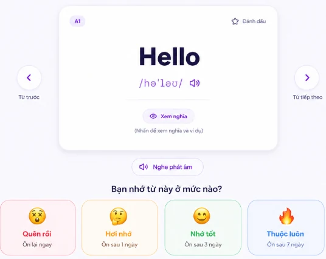

<p align="center">
  
</p>

<h1 align="center">VocabLearning</h1>

<p align="center">
  <strong>Ứng dụng học Tiếng Anh lớp 1 (Global Success) theo phong cách Duolingo × Babilala.</strong>
</p>

<p align="center"><a href="https://vocablearning.online/">Live site</a></p>

<p align="center">
  
</p>

I worked in a team of three and wrote most of the frontend and backend, including the review flow.

---

## 1. Overview

VocabLearning is a full-stack primary-school English learning web application built around the official **Tiếng Anh 1 – Global Success** curriculum (16 Units across Semester 1 & Semester 2, 64 core vocabulary words, phonics, and sentence patterns).

The platform includes:
- **Learner experience** designed for 6–7-year-old Vietnamese first graders: voice-first guidance, Candy Crush × Duolingo winding S-curve adventure map, interactive textbook activities (*Look & Trace*, *Listen & Repeat*, *Listen & Tick*, *Listen & Chant*, *Let's Talk*), mini-games arcade, standalone flashcards, silent SM-2 spaced repetition, and an animated 2D vector Rive owl companion (**Lumo**).
- **Admin dashboard** for managing vocabulary, topics, exercises, users, and learning analytics.

## 2. Key Features

### Learner (Primary School · Tiếng Anh 1 – Global Success)
- **Winding Adventure Map (`/learning`)**:
  - 16 Units split into **Học kỳ 1 (Unit 1–8)** and **Học kỳ 2 (Unit 9–16)** on a smooth cubic Bézier S-curve trail.
  - 4 **Milestone Boss Checkpoints (`Review 1–4`)** after every 4 Units (matching the official textbook structure).
  - Parent/teacher **Mở tự do** unlock toggle and 1–3 golden stars per island.
- **Interactive Unit Lessons (Global Success × Babilala)**:
  - **Look & Trace**: HTML5 Canvas stencil-clipped letter tracing on Grade 1 notebook lines with real per-letter pixel coverage detection.
  - **Listen & Repeat**: Tap-anywhere-to-hear vocabulary cards with human neural audio (`en-US-EmmaMultilingualNeural`) and microphone speak-along practice.
  - **Listen & Tick ✓**: Official textbook checkbox listening mini-game.
  - **Listen & Chant**: Interactive rhythm chant with soft Web Audio marimba beat and synced bouncing picture cards.
  - **Let's Talk & Unit Boss Check**: Dedicated sentence pattern practice and end-of-unit quiz.
- **Silent SM-2 Spaced Repetition**: SuperMemo-2 scheduling runs automatically under the hood to surface timely review sessions (`Ôn bài cùng Lumo!`) without technical jargon.
- **Babilala Game Park (`/games`)**: 3 kid-friendly mini-games (*Nghe & Chạm tranh*, *Bong bóng Phonics*, *Ghép Loa & Hình*) with custom 2D flat-vector posters.
- **Flashcards (`/flashcards`) & Dictionary (`/vocabulary`)**: Standalone quick-review flashcards (with SM-2 self-rating) and searchable 64-word visual dictionary.
- **Animated Companion (Lumo)**: Interactive 2D vector Rive owl mascot (`@rive-app/react-canvas`) with draggable/resizable floating tutor window.
- **Accounts & Progress**: Email + password auth, learner Google OAuth, leaderboard, personal sticky notes, and profile customization.

### Admin
- Vocabulary CRUD (word, IPA, image, audio, examples, topic)
- Topic CRUD with parent/child hierarchy
- Exercise management per word
- User management (block, unblock, delete, promote)
- Learning analytics dashboard

## 3. Tech Stack

| Layer | Tech |
|---|---|
| Frontend | React 19, Vite 6, TypeScript 5.8, Tailwind CSS 4, React Router 7, Rive (`@rive-app/react-canvas`), Lucide Icons |
| Backend | ASP.NET Core (.NET 10), C#, Entity Framework Core |
| Database | PostgreSQL 16 (with Grade 1 Global Success 16-Unit seed) |
| Auth | Cookie-based sessions + CSRF (anti-forgery), PBKDF2-SHA256 password hashing, Google OAuth |
| Testing | Vitest, Playwright E2E |

## 4. Local Setup

### Prerequisites
- Node.js 20+
- .NET 10 SDK
- PostgreSQL 16 (local or Docker)

### Database

Create a local Postgres database, apply the schema, and load the Grade 1 Global Success seed:

```bash
createdb vocablearning
psql -d vocablearning -f database/postgres/init.sql
psql -d vocablearning -f database/postgres/migrations/2026_11_25_add_vocabulary_image_url.sql
psql -d vocablearning -f database/postgres/seeds/2026_11_26_grade1_global_success_16_units.sql
```

### Environment Variables
- Copy `.env.example` → `.env` at the repo root (for Docker Compose / backend env).
- Copy `frontend/.env.example` → `frontend/.env` for Vite.
- Configure the database connection in `backend/VocabLearning/appsettings.Development.json` or via `ConnectionStrings__DefaultConnection`.

### Backend

```bash
cd backend/VocabLearning
dotnet restore
ASPNETCORE_ENVIRONMENT=Development dotnet run --urls http://localhost:5152
```

### Frontend

```bash
cd frontend
npm install
npm run dev      # http://localhost:3000 (proxies /api -> backend)
npm run lint     # TypeScript typecheck (tsc --noEmit)
npm run build    # Production build
npm run test:e2e # Playwright E2E tests
```

### Optional Integrations
- `GOOGLE_CLIENT_ID` / `GOOGLE_CLIENT_SECRET` — enables learner Google sign-in
- `GEMINI_API_KEY` — enables Lumo AI explanations
- `SMTP_*` — enables password-reset email delivery

## 5. Deployment

- **Frontend**: Vercel (`vocablearning.online`, configured via `frontend/vercel.json`)
- **Backend API**: Render (`pbl3-vocab-web.onrender.com`)
- **Database**: Managed PostgreSQL
- **Branches**: `main` (PR target), `production` (deploy branch)
